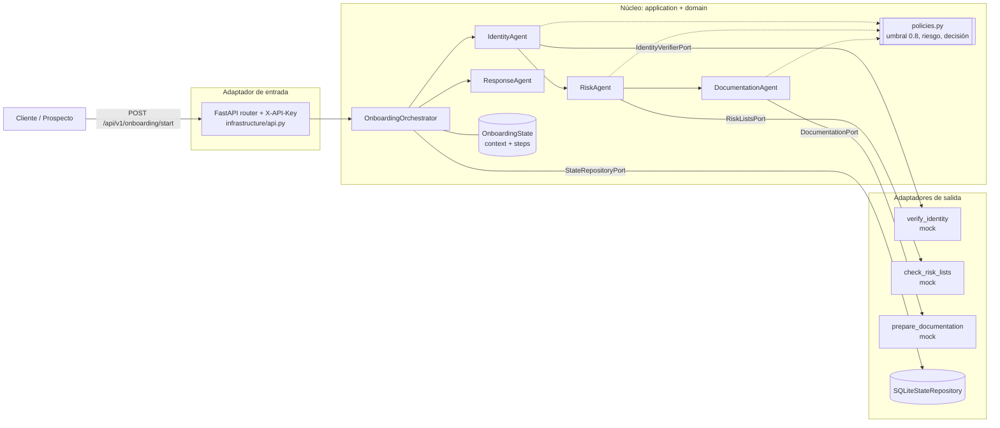
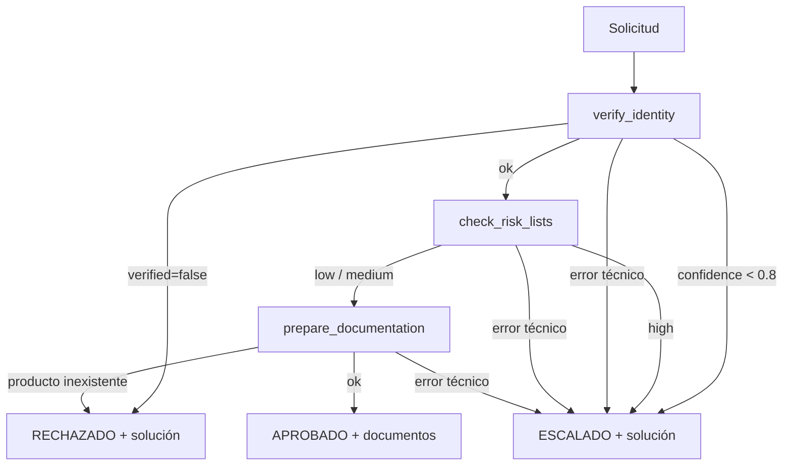

# Onboarding digital: agente orquestador (MVP)

Un agente orquestador coordina sub-agentes especializados (identidad, riesgo, documentación y respuesta), aplica las políticas del banco y decide si el prospecto es **APROBADO**, **RECHAZADO** o **ESCALADO** (revisión humana). Cuando algo falla o es ambiguo, propone una solución.

Arquitectura hexagonal (puertos y adaptadores). Dependencias: `fastapi` y `uvicorn` (`httpx` solo para los tests).

## Diagrama de arquitectura



### Flujo de decisión



## Estructura

```text
app/
  domain/            # núcleo puro, sin dependencias
    models.py        # Prospect, OnboardingState, StepResult, Decision
    policies.py      # reglas del banco (umbrales, decisión final)
  application/
    ports.py         # interfaces de las tools y del repositorio
    agents.py        # sub-agentes especializados + ResponseAgent
    orchestrator.py  # orquestador: plan, estado, corte por incertidumbre
  infrastructure/
    api.py           # adaptador HTTP (FastAPI) + autenticación por API key
    mock_tools.py    # mocks de las 3 tools
    sqlite_repository.py  # persistencia del estado (sqlite3 de la stdlib)
  main.py            # composition root (inyección de dependencias, config por entorno)
tests/test_onboarding.py
```

### Decisiones de diseño

- **Control de herramientas:** cada sub-agente recibe por constructor solo el puerto de su tool. `IdentityAgent` no puede consultar listas, `RiskAgent` no puede generar documentos, etc.
- **Estado entre pasos:** `OnboardingState.context` guarda la salida de cada agente; `DocumentationAgent` usa el `risk_level` del paso anterior para aplicar la debida diligencia reforzada. El estado se persiste en SQLite (sobrevive reinicios) y se consulta con `GET /api/v1/onboarding/{id}`.
- **Incertidumbre:** el orquestador corta el flujo en el primer paso no-OK. La confianza baja, el riesgo alto o cualquier excepción de una tool escalan a revisión humana; nunca se aprueba por defecto. Cada caso trae una `proposed_solution`.
- **Respuesta al cliente:** `ResponseAgent` no revela al cliente coincidencias en listas restrictivas; ese detalle queda solo en el `trace` interno.
- **Seguridad:** todos los endpoints exigen el header `X-API-Key`; la clave se compara en tiempo constante. La app no arranca si `ONBOARDING_API_KEY` no está definida, para que nunca quede abierta por error.
- **Validación de datos (también con mocks):** las reglas viven en [validators.py](app/domain/validators.py) y se aplican dos veces: en la API (responde 422 antes de invocar cualquier tool) y como invariante de `Prospect`, de modo que el dominio nunca acepta datos inválidos.
  - `document_id`: cédula ecuatoriana con 10 dígitos, provincia 01–24 (o 30, extranjeros), tercer dígito < 6 y dígito verificador módulo 10.
  - `prospect_name`: nombre y apellido, solo letras (incluye tildes y ñ); se normalizan los espacios.
  - **Ojo:** el ejemplo del enunciado `1712345678` **no** tiene un dígito verificador válido y responde 422. Su equivalente válido es `1712345675`.

## Ejecutar

```bash
uv sync
cp .env.example .env                     # define ONBOARDING_API_KEY
uv run --env-file .env uvicorn app.main:build_app --factory --reload
uv run python -m unittest -v             # tests
```

Swagger en <http://127.0.0.1:8000/docs> (botón **Authorize** → pega la API key).

```bash
curl -X POST http://127.0.0.1:8000/api/v1/onboarding/start \
  -H "X-API-Key: <tu-clave>" \
  -H "Content-Type: application/json" \
  -d '{"prospect_name": "Juan Perez", "document_id": "1712345675", "product": "cuenta_ahorros"}'
```

## Escenarios simulados

| document_id  | product          | Resultado | Motivo |
|--------------|------------------|-----------|--------|
| `1712345675` | `cuenta_ahorros` | APROBADO  | Cliente limpio |
| `1733333338` | cualquiera válido | APROBADO  | Riesgo medio (PEP): exige documentos de debida diligencia |
| `1700000001` | cualquiera       | RECHAZADO | Identidad no verificada |
| cualquiera   | `hipoteca`       | RECHAZADO | Producto fuera de catálogo |
| `1711111110` | cualquiera       | ESCALADO  | Confianza 0.65 < 0.8 |
| `1722222229` | cualquiera       | ESCALADO  | Riesgo alto (OFAC) |

Productos válidos: `cuenta_ahorros`, `cuenta_corriente`, `tarjeta_credito`.

## Respuesta (ejemplo aprobado)

```json
{
  "onboarding_id": "…",
  "created_at": "…",
  "status": "APROBADO",
  "apto": true,
  "message": "Hola Juan, tu solicitud de cuenta ahorros fue aprobada. Para finalizar, por favor carga: copia_cedula, planilla_servicio_basico, contrato_cuenta_ahorros.",
  "required_documents": ["copia_cedula", "planilla_servicio_basico", "contrato_cuenta_ahorros"],
  "proposed_solution": null,
  "trace": [
    {"agent": "identity", "tool": "verify_identity", "status": "ok", "output": {"verified": true, "confidence": 0.95}, "reason": null},
    {"agent": "risk", "tool": "check_risk_lists", "status": "ok", "output": {"risk_level": "low", "matches": []}, "reason": null},
    {"agent": "documentation", "tool": "prepare_documentation", "status": "ok", "output": {"product": "cuenta_ahorros", "required_documents": ["…"]}, "reason": null}
  ]
}
```

`apto` vale `true` (aprobado), `false` (rechazado) o `null` (escalado: lo decide una persona).

## Siguientes pasos (fuera del MVP)

- Reemplazar los mocks por clientes reales (registro civil, listas OFAC/ONU, gestor documental): solo hay que agregar nuevos adaptadores de los puertos.
- Migrar de SQLite a Postgres (p. ej. Neon) con otro adaptador de `StateRepositoryPort`, y agregar un endpoint para que el analista resuelva los casos escalados.
- Reemplazar la API key por OAuth2/JWT con roles (canal digital vs. analista).
- Si se requiere razonamiento en lenguaje natural, cambiar `ResponseAgent` o el orquestador por un LLM con tool-use, sin tocar las políticas ni los puertos.
